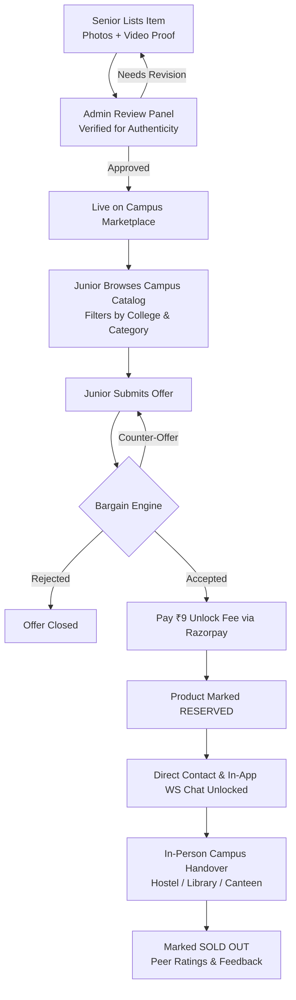

<div align="center">

# 🎓 Student Cube

### **The Hyperlocal Peer-to-Peer Campus Marketplace**

[](https://studentcube.vercel.app)
[](https://react.dev/)
[](https://www.typescriptlang.org/)
[](https://vitejs.dev/)
[](https://tailwindcss.com/)
[](https://nodejs.org/)
[](https://expressjs.com/)
[](https://www.mongodb.com/)
[](https://developer.mozilla.org/en-US/docs/Web/API/WebSockets_API)
[](https://razorpay.com/)

<br />

> 🌐 **Explore the Live Platform:** **[https://studentcube.vercel.app](https://studentcube.vercel.app)**  
> *Buy, sell, negotiate, and exchange academic gear directly inside your college campus.*

<br />

</div>

---

## 📌 Table of Contents

- [Overview & Vision](#-overview--vision)
- [Why Student Cube?](#-why-student-cube)
- [Key Features](#-key-features)
- [Campus Workflow](#-campus-workflow)
- [Supported Campuses](#-supported-campuses)
- [Tech Stack Architecture](#-tech-stack-architecture)
- [Project Structure](#-project-structure)
- [Getting Started](#-getting-started)
  - [Prerequisites](#prerequisites)
  - [1. Backend Setup](#1-backend-setup)
  - [2. Frontend Setup](#2-frontend-setup)
- [Environment Configuration](#-environment-configuration)
- [API & WebSocket Protocol](#-api--websocket-protocol)
- [Security & Trust Mechanisms](#-security--trust-mechanisms)
- [Campus Ambassador Program](#-campus-ambassador-program)
- [Contributing](#-contributing)
- [License](#-license)

---

## 💡 Overview & Vision

Every semester, college and engineering students spend thousands of rupees on specialized tools, lab equipment, and textbooks that are only used for 3 to 6 months—such as:
- **Scientific Calculators** (Casio FX-991EX / MS series)
- **Engineering Drafters & Drawing Sheets**
- **Lab Coats, Aprons & Workshop Gear**
- **IoT, Arduino & Robotics Starter Kits**
- **Semester Reference Books & Assignment Guides (Aakash/PK)**

Meanwhile, senior batches have these exact items gathering dust in hostel lockers and dorm cupboards. General marketplaces (OLX, Quikr) fail for students due to high courier costs, safety concerns, strangers off-campus, and spam.

**Student Cube** bridges this gap by creating a **closed-loop, verified campus marketplace**:
- 🏷️ **Juniors Save 50–70%** on semester kits without waiting for commercial deliveries.
- 💰 **Seniors Monetize Instantly** by clearing their desks right on campus.
- 🤝 **Zero Shipping & Zero Fraud**: 100% face-to-face handovers between verified college peers.

---

## ⚖️ Why Student Cube?

| Problem in College Campuses | The Student Cube Solution |
| :--- | :--- |
| **High Costs Every Semester** | Buy pre-owned tools at a fraction of retail price from your own seniors. |
| **Shipping Fees & Delivery Delays** | **Zero logistics overhead.** Meet at the canteen, library, or hostel gate. |
| **Spam & Ghost Buyers** | Smart **₹9 Token Unlock** filters out window shoppers and confirms serious buyers. |
| **Defective Gear or Broken Drafters** | Compulsory video proof & physical verification before cash changes hands. |
| **Awkward In-Person Haggling** | Built-in **Bargaining Engine** with real-time offer & counter-offer counters. |

---

## 🚀 Key Features

### 🛒 1. Smart Campus Catalog & Filters
- **Departmental Categories**: Books & Notes, Calculators, Drafters & Instruments, Aakash/Assignment Material, Lab Coats, Electronics & Gadgets, IoT & Robotics.
- **Campus Multi-Tenancy**: Filter listings by college (IIT Delhi, DTU, NSUT, USICT, MAIT, MSIT, and more) to see items physically present in your vicinity.
- **Condition & Price Transparency**: Clear tags (`Brand New`, `Like New`, `Gently Used`, `Fair`) with discount percentages calculated automatically.

### 💬 2. Real-Time Chat & Bargaining Engine
- **WebSockets Engine**: Instant messaging with unread count badges, read receipts, and live typing states.
- **Interactive Offers**: Buyers make bids, sellers can **Accept**, **Reject**, or submit a **Counter-Offer** directly within the chat interface.
- **Automated Lifecycle Notifications**: Automated alerts for deal status updates, reservation expiries, and email notifications for offline users.

### 🔒 3. Anti-Ghosting Contact Unlock (₹9 Safety Gate)
- When a buyer's offer is accepted, they pay a nominal **₹9 commitment fee** via **Razorpay**.
- This unlocks the seller’s verified phone/WhatsApp number and contact card.
- The item shifts to **`RESERVED`** status for 24 hours, preventing other buyers from snatching it while waitlisting backup prospects.

### 🛡️ 4. Admin Review & Moderation Panel
- Every product listing undergoes strict admin verification for price sanity, appropriate imagery, and video demo proof.
- Admins can approve, reject (with constructive feedback reason), feature products on the homepage, and manage flagged listings.

### 🎓 5. Campus Ambassador & Referral Engine
- Dedicated **Ambassador Portal** for college representatives.
- Custom referral codes with automated commission payouts (`₹5` per listing referral) and live wallet balance tracking.
- Admin dashboard to track ambassador performance, process payouts, and audit referral usage.

### 🎨 6. Modern, Fluid User Experience
- Built with **React 19**, **Tailwind CSS v4**, **GSAP**, and **Framer Motion**.
- Seamless **Light & Dark Mode** toggle with persistent storage.
- Full Google OAuth 2.0 integration for frictionless one-click sign-in.
- Dynamic SEO optimization with automated XML sitemaps (`/api/sitemap.xml`) and social OpenGraph tags.

---

## 🔄 Campus Workflow



---

## 🏫 Supported Campuses

Student Cube currently powers peer-to-peer exchanges across premier institutes, with ongoing multi-campus rollouts:

- 🏛️ **IIT Delhi** *(Indian Institute of Technology Delhi)*
- 🏛️ **DTU** *(Delhi Technological University)*
- 🏛️ **NSUT** *(Netaji Subhas University of Technology)*
- 🏛️ **IIIT Delhi** *(Indraprastha Institute of Information Technology)*
- 🏛️ **IGDTUW** *(Indira Gandhi Delhi Technical University for Women)*
- 🏛️ **USICT / USAR** *(GGSIPU Main Campuses, Dwarka & East Delhi)*
- 🏛️ **MAIT** *(Maharaja Agrasen Institute of Technology)*
- 🏛️ **MSIT / MSI** *(Maharaja Surajmal Institute of Technology)*
- 🏛️ **BPIT** *(Bhagwan Parshuram Institute of Technology)*
- 🏛️ **BVCOE** *(Bharati Vidyapeeth's College of Engineering)*
- 🏛️ **ADGITM**, **GTBIT**, **JMI**, **DTC**, **VIPS**, and more.

---

## 🛠️ Tech Stack Architecture

```
┌─────────────────────────────────────────────────────────────┐
│                       STUDENT CUBE                          │
└─────────────────────────────────────────────────────────────┘
                              │
         ┌────────────────────┴────────────────────┐
         ▼                                         ▼
┌──────────────────┐                     ┌──────────────────┐
│     CLIENT       │                     │      SERVER      │
│  (student_cube)  │                     │(student_cube_... │
└──────────────────┘                     └──────────────────┘
  • React 19 + TypeScript                  • Node.js & Express (ESM)
  • Vite 8 Bundler                         • MongoDB & Mongoose
  • Tailwind CSS v4                        • WebSockets (`ws` protocol)
  • TanStack Query v5                      • JWT Authentication
  • Framer Motion & GSAP                   • Razorpay Payment Gateway
  • Lucide React Icons                     • Cloudinary Cloud Storage
  • React Router DOM v7                    • Brevo / Nodemailer Emails
  • Google OAuth 2.0                       • Helmet, CORS, Rate-Limiting
```

---

## 📁 Project Structure

```text
student_cube/
├── student_cube/                     # Frontend Client (React + Vite + TS)
│   ├── src/
│   │   ├── components/               # Reusable UI components & modals
│   │   │   ├── AdminAmbassadorsPanel.tsx
│   │   │   ├── AdminReviewPanel.tsx
│   │   │   ├── BrowseCategories.tsx
│   │   │   ├── HeroSection.tsx
│   │   │   ├── Navbar.tsx
│   │   │   ├── RealtimeBridge.tsx    # WebSocket connection bridge
│   │   │   └── ...
│   │   ├── context/                  # AuthContext, ThemeContext
│   │   ├── hooks/                    # Custom React hooks (DevTools, Realtime)
│   │   ├── pages/                    # Route Views
│   │   │   ├── Index.tsx             # Landing Page
│   │   │   ├── BrowseProducts.tsx    # Catalog & Filter View
│   │   │   ├── ProductDetail.tsx     # Item Details & Offer Sheet
│   │   │   ├── Chat.tsx              # WebSockets Chat & Bargain Hub
│   │   │   ├── Sell.tsx              # Listing Creation with Cloudinary
│   │   │   ├── Profile.tsx           # User History & Active Bids
│   │   │   ├── AdminDashboard.tsx    # Admin Moderation Panel
│   │   │   └── AmbassadorDashboard.tsx
│   │   ├── utils/                    # API client instance (Axios)
│   │   └── App.tsx                   # Main Routing Table
│   ├── index.html
│   ├── vite.config.ts
│   └── package.json
│
├── student_cube_backend/             # REST API & WebSockets Server
│   ├── src/
│   │   ├── config/                   # MongoDB connection configuration
│   │   ├── controllers/              # Route controllers (Auth, Products, Chat, Offers, Payment)
│   │   ├── middlewares/              # JWT protect, Admin verify, Rate Limiters
│   │   ├── models/                   # Mongoose Schemas (User, Product, Offer, Chat, Message)
│   │   ├── routes/                   # Express Routers
│   │   ├── utils/                    # College definitions, Cloudinary, Cron, Email
│   │   └── server.js                 # Server entry & WebSockets initialization
│   └── package.json
│
└── README.md                         # Project documentation
```

---

## 🚀 Getting Started

Follow these steps to get a local instance of Student Cube running on your development machine.

### Prerequisites

Ensure you have the following installed:
- **Node.js** (v18.0.0 or higher) — [Download Node.js](https://nodejs.org/)
- **npm** or **pnpm** / **yarn**
- **MongoDB** instance (local or MongoDB Atlas connection URI)
- Free accounts for **Cloudinary** (media hosting) and **Razorpay** (test mode keys)

---

### 1. Backend Setup

```bash
# 1. Navigate to the backend directory
cd student_cube_backend

# 2. Install dependencies
npm install

# 3. Create your environment configuration file
cp .env.example .env
# Edit .env with your MongoDB URI, JWT secret, Cloudinary, and Razorpay keys

# 4. Launch backend in development mode (with nodemon)
npm run dev
```

*The server will start on `http://localhost:5000` with the WebSocket endpoint active at `ws://localhost:5000/ws/chat`.*

---

### 2. Frontend Setup

```bash
# 1. Navigate to the frontend directory
cd ../student_cube

# 2. Install dependencies
npm install

# 3. Create your environment configuration file
cp .env.example .env
# Update VITE_API_BASE_URL and credentials

# 4. Start the Vite development server
npm run dev
```

*Open `http://localhost:5173` in your browser.*

---

## 🔐 Environment Configuration

### Frontend (`student_cube/.env`)

```ini
# Backend API Base URL
VITE_API_BASE_URL=http://localhost:5000/api

# Google OAuth Client ID (from Google Cloud Console)
VITE_GOOGLE_CLIENT_ID=your_google_client_id_here.apps.googleusercontent.com

# Razorpay Key ID (Test or Live Key)
VITE_RAZORPAY_KEY_ID=rzp_test_your_razorpay_key_id
```

### Backend (`student_cube_backend/.env`)

```ini
# Server Port & Allowed Frontend URL
PORT=5000
CLIENT_URL=http://localhost:5173

# Database Connection
MONGO_URI=mongodb+srv://<username>:<password>@cluster.mongodb.net/student_cube

# Authentication
JWT_SECRET=your_jwt_super_secret_key

# Cloudinary (Media Hosting for Listings)
CLOUDINARY_CLOUD_NAME=your_cloud_name
CLOUDINARY_API_KEY=your_cloudinary_api_key
CLOUDINARY_API_SECRET=your_cloudinary_api_secret

# Razorpay (Gated Contact Unlock Fee)
RAZORPAY_KEY_ID=rzp_test_your_razorpay_key_id
RAZORPAY_KEY_SECRET=your_razorpay_key_secret

# Email Gateway (Transactional Notifications)
BREVO_API_KEY=your_brevo_api_key
BREVO_SENDER_EMAIL=support@studentcube.com
BREVO_SENDER_NAME="StudentCube"
```

---

## 📡 API & WebSocket Protocol

### Core REST Endpoints

| Method | Endpoint | Description | Auth Required |
| :--- | :--- | :--- | :---: |
| `POST` | `/api/auth/register` | Register new student account with OTP verification | ❌ |
| `POST` | `/api/auth/login` | Email/password login | ❌ |
| `POST` | `/api/auth/google` | Google OAuth one-tap authentication | ❌ |
| `GET` | `/api/products` | Fetch paginated catalog with category, price & college filters | ❌ |
| `POST` | `/api/products` | Create a new listing with images and video proof | ✅ |
| `GET` | `/api/products/:id` | Fetch product details & seller metadata | ❌ |
| `POST` | `/api/offers` | Submit an initial bargain offer on an item | ✅ |
| `PUT` | `/api/offers/:id/counter` | Seller submits counter-offer | ✅ |
| `PUT` | `/api/offers/:id/accept` | Accept offer & trigger lock period | ✅ |
| `POST` | `/api/payment/create-order` | Generate Razorpay order for ₹9 unlock | ✅ |
| `POST` | `/api/payment/verify-order` | Verify signature & release seller contact details | ✅ |
| `GET` | `/api/ambassador/dashboard` | Ambassador metrics, referrals & earnings | ✅ (Ambassador) |
| `GET` | `/api/sitemap.xml` | Dynamic SEO sitemap with product canonicals | ❌ |

### WebSocket Events (`/ws/chat?token=<JWT>`)

| Event Type | Direction | Payload Description |
| :--- | :---: | :--- |
| `join` | Client ➔ Server | Join a specific offer negotiation room (`{ offerId }`) |
| `message` | Client ➔ Server | Send text message inside the offer room |
| `joined` | Server ➔ Client | Confirms client joined chat room |
| `chat_message` | Server ➔ Client | Broadcasts newly delivered message to room participants |
| `offer_updated` | Server ➔ Client | Notifies buyer/seller when an offer is accepted, countered, or paid |

---

## 🛡️ Security & Trust Mechanisms

- **Daylight & Campus-Only Guidelines**: Users are repeatedly guided to conduct transactions in open public spaces on campus (libraries, canteens, university main gates) during daytime.
- **₹9 Skin-in-the-Game Deposit**: Prevents bots, automated scrapers, and flippers from monopolizing campus listings.
- **Pre-Screening Moderation**: All newly posted products sit in a `pending` state until verified by the moderation team, protecting buyers from spam or prohibited goods.
- **Auto-Expiry Reservation Engine**: Background cron monitors accepted offers; if unfulfilled within 24 hours, items return to `AVAILABLE` status for the waitlist.
- **Client DevTools Protection**: Hardened against tampering during checkout and payment handshakes.

---

## 🤝 Campus Ambassador Program

Student Cube thrives on student leaders. Campus Ambassadors:
- 📢 Represent Student Cube in their respective colleges & university societies.
- 🏷️ Distribute exclusive campus promo codes.
- 💵 Earn transparent referral commissions directly credited to their in-app wallet.
- 📈 Access a live analytics dashboard tracking referral conversions, active listings, and payout histories.

*Interested in bringing Student Cube to your college? Visit [studentcube.vercel.app](https://studentcube.vercel.app) to apply!*

---

## 👥 Contributing

Contributions, bug reports, and suggestions are warmly welcomed!

1. **Fork the Repository**
2. **Create a Feature Branch** (`git checkout -b feature/AmazingFeature`)
3. **Commit your Changes** (`git commit -m 'feat: Add AmazingFeature'`)
4. **Push to the Branch** (`git push origin feature/AmazingFeature`)
5. **Open a Pull Request**

---

## 📄 License

Distributed under the **MIT License**. See `LICENSE` for more information.

---

<div align="center">

Made with ❤️ by students, for students.

**[🌐 Visit Student Cube Live](https://studentcube.vercel.app)** • **[🐛 Report a Bug](https://github.com/StudentCube/Student_Cube/issues)** • **[💡 Request a Feature](https://github.com/StudentCube/Student_Cube/discussions)**

</div>
